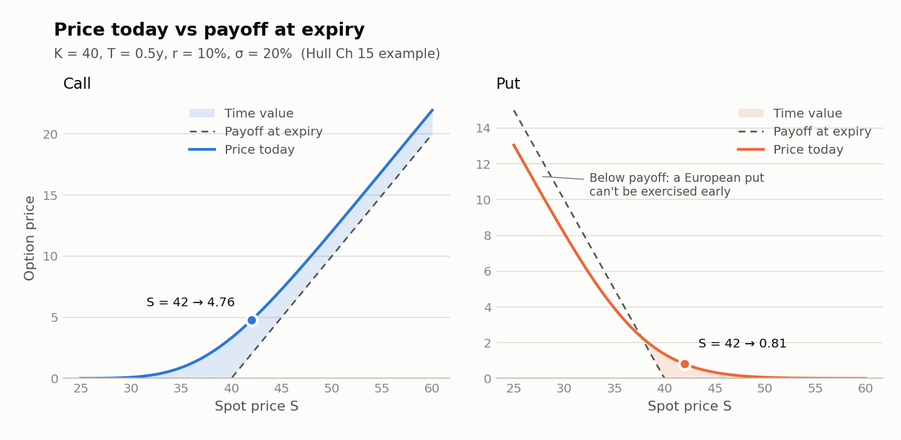
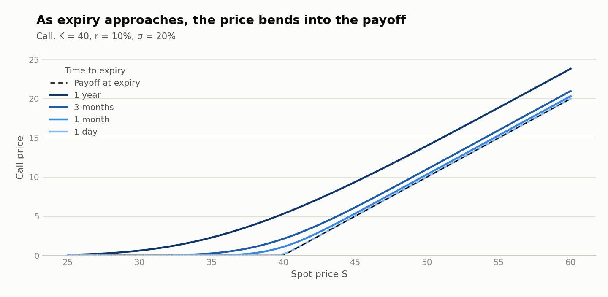
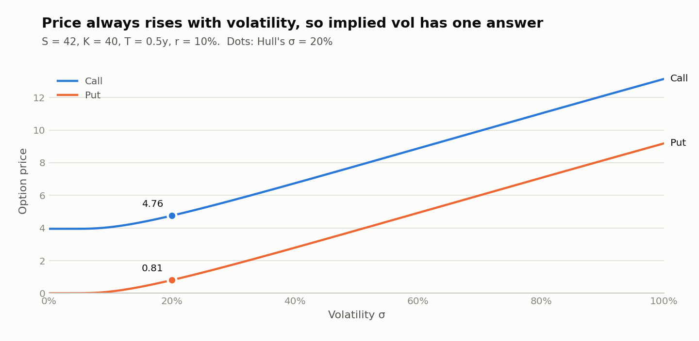

# options-pricing-engine

[](https://github.com/Sashwat1417/options-pricing-engine/actions/workflows/ci.yml)

Multi-layer C++ options pricing engine: closed-form Black-Scholes, Monte Carlo simulation, and delta-hedging P&amp;L, with Python visualisation.

**Live demo: https://ope-server.onrender.com** (free tier: the first request after 15 idle minutes takes about a minute)

<picture>
  <source media="(prefers-color-scheme: dark)" srcset="docs/images/price_vs_spot-dark.png">
  
</picture>

<picture>
  <source media="(prefers-color-scheme: dark)" srcset="docs/images/time_decay-dark.png">
  
</picture>

<picture>
  <source media="(prefers-color-scheme: dark)" srcset="docs/images/price_vs_vol-dark.png">
  
</picture>

## Build and test

Requires CMake ≥ 3.28 and a C++17 compiler. GoogleTest is downloaded automatically.

```sh
# configure + build + test in one go (debug, warnings as errors, sanitizers on)
cmake --workflow --preset debug

# or step by step
cmake --preset debug
cmake --build --preset debug
ctest --preset debug

# optimised build
cmake --preset release && cmake --build --preset release && ctest --preset release
```

## Command-line tool

After building, the `ope` binary is at `build/debug/cli/ope` (or `build/release/cli/ope`).

```sh
# price a call (Hull Ch 15 example)
ope price --type call --spot 42 --strike 40 --expiry 0.5 --rate 0.1 --vol 0.2
# 4.759422

# implied volatility from a market price
ope iv --type call --spot 42 --strike 40 --expiry 0.5 --rate 0.1 --price 4.76
# 0.200066

# CSV of call and put prices across a range of spot, vol or expiry
ope sweep --spot 42 --strike 40 --expiry 0.5 --rate 0.1 --vol 0.2 --vary spot --from 20 --to 60 --steps 200
```

## Web UI

`ope-server` also serves a page at `/`: option inputs, live call/put prices, an implied-vol
calculator and interactive charts. The page only displays; every number comes from the API.

```sh
build/debug/server/ope-server            # then open http://localhost:8080
```

The UI files live in `server/web/`. Set `WEB_DIR` to serve them from elsewhere.

## Continuous integration

`.github/workflows/ci.yml` runs on every PR and push to `develop` / `main`:

| Job | What it checks |
|---|---|
| Test (Linux · g++) | `cmake --workflow --preset debug`: Werror + ASan/UBSan, all tests |
| Test (macOS · clang) | the same on macOS |
| Docker image | builds the image (runs ctest inside), starts it, curls `/health`, the API and the UI |

## Deployment (Render)

`render.yaml` is a Render Blueprint: a Docker web service on the free plan in Singapore,
health-checked on `/health`. Render rebuilds and deploys from `main` after GitHub CI passes
(`autoDeployTrigger: checksPass`). Free instances sleep after 15 idle minutes; the first
request after that takes about a minute.

## Docker

```sh
docker build -t ope-server .                  # compiles and runs the tests on Linux/g++
docker run --rm -p 8080:8080 ope-server       # then open http://localhost:8080
```

Multi-stage build on Ubuntu 24.04: the build stage compiles and tests; the runtime image
(~140 MB) holds only `ope-server` and `server/web/`, runs as a non-root user, reads `PORT`
(default 8080), and shuts down cleanly on `docker stop`.

## Kubernetes

`k8s/ope-server.yaml` runs 3 replicas spread across nodes, with `/health` readiness and liveness
probes, resource requests/limits, and a Service in front.

```sh
docker build -t ope-server .
kubectl apply -f k8s/ope-server.yaml
kubectl get pods -o wide                              # NODE column shows the spread
kubectl port-forward service/ope-server 8080:8080     # then open http://localhost:8080
```

Tested on Docker Desktop's kind cluster (1 control plane + 2 workers).

## REST API

```sh
build/debug/server/ope-server            # listens on $PORT, default 8080

curl localhost:8080/health
# {"status":"ok"}

curl localhost:8080/api/v1/price -H 'Content-Type: application/json' \
     -d '{"type":"call","spot":42,"strike":40,"expiry":0.5,"rate":0.1,"vol":0.2}'
# {"price":4.759422392871535}
```

| Endpoint | Body | Response |
|---|---|---|
| `GET /health` | | `{"status":"ok"}` |
| `GET /version` | | `{"version": "0.2.1", "commit": "<deployed git sha>"}` |
| `POST /api/v1/price` | `type, spot, strike, expiry, rate, vol` | `{"price": …}` |
| `POST /api/v1/iv` | `type, spot, strike, expiry, rate, price` | `{"implied_vol": …}` |
| `POST /api/v1/sweep` | `spot, strike, expiry, rate, vol, vary, from, to, steps` (`vol` not needed when `vary` is `vol`) | arrays `x, call, put, call_payoff, put_payoff, call_delta, put_delta, call_theta, put_theta` |
| `POST /api/v1/greeks` | `type, spot, strike, expiry, rate, vol` | `{"delta": 0.5216…, "theta": −4.3054…}` (theta per year) |

Bad input returns `400 {"error": "..."}`. Bodies over 64 KB get `413`. Each request is logged as one JSON line with its duration.

## Charts

Python only draws: `viz/plot.py` runs `ope sweep` and plots the CSV it returns.

```sh
python3 -m venv viz/.venv && viz/.venv/bin/pip install -r viz/requirements.txt
viz/.venv/bin/python viz/plot.py          # writes docs/images/*.png (light + dark)
```

## Layout

One directory per layer. Each one has `main/` for code and `test/` for its tests.

```
black_scholes/                Layer 1 (target: ope::black_scholes)
├── main/include/ope/         public headers
├── main/src/                 implementation
└── test/                     GoogleTest unit tests
cli/                          `ope` command-line tool
├── main/src/
└── test/                     smoke tests that run the binary
server/                       `ope-server` REST API
├── main/src/api/             PricingController (JSON API), HealthController, WebController (UI)
├── main/src/config/          ServerConfig: env vars, payload/timeout limits
├── main/src/service/         PricingService: calls ope::black_scholes
├── main/src/request/         PriceRequest, IvRequest, SweepRequest (+ JsonReader)
├── main/src/response/        PriceResponse, IvResponse, SweepResponse, ErrorResponse
├── web/                      index.html, app.css, app.js (display only)
└── test/                     api/ (real HTTP), request/ and service/ tests
cmake/                        shared build helpers (warnings, sanitizers, GoogleTest, CLI11, httplib, json)
viz/                          Python plotting (draws only, no pricing logic)
docs/images/                  generated charts
```
